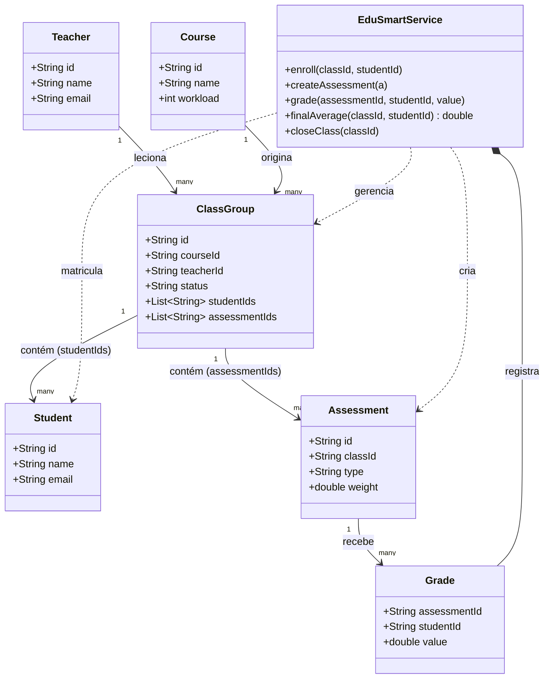

# Modelo UML — 7 classes principais do EduSmart

As 7 classes escolhidas cobrem todo o domínio do sistema: professor e curso dão origem à turma, o aluno é matriculado nela, a turma tem avaliações, e as avaliações geram notas. Tudo isso é orquestrado pela `EduSmartService`.

## Diagrama de classes

## O que cada classe faz

| Classe | Função |
|---|---|
| `EduSmartService` | Classe central: matricula alunos, cria avaliações, lança notas, calcula médias e fecha turmas |
| `Student` | Representa o aluno |
| `Teacher` | Representa o professor responsável pela turma |
| `Course` | Representa o curso ao qual a turma pertence |
| `ClassGroup` | Representa a turma, ligada a um curso e um professor, com a lista de alunos e avaliações |
| `Assessment` | Representa uma avaliação da turma |
| `Grade` | Representa a nota de um aluno numa avaliação |

## Fluxo básico

1. Um `Course` e um `Teacher` dão origem a uma `ClassGroup` (a turma).
2. Um `Student` é matriculado nessa `ClassGroup` através da `EduSmartService`.
3. A `ClassGroup` recebe uma ou mais `Assessment`.
4. Cada `Assessment` recebe `Grade`s dos alunos matriculados.
5. A `EduSmartService` usa essas notas para calcular a média final do aluno na turma.

