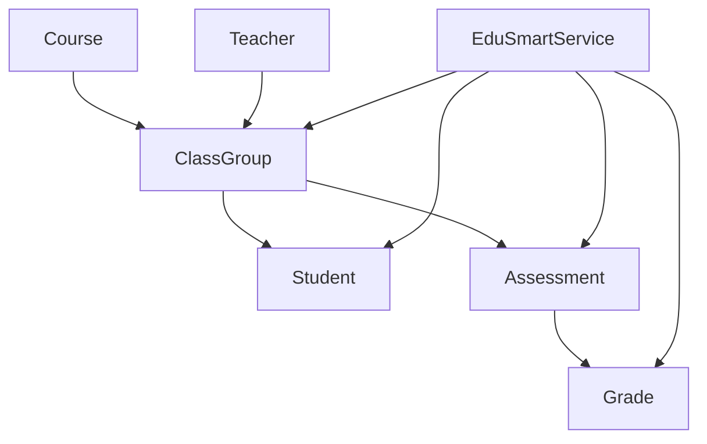

# Diagrama de componentes — 7 elementos principais do EduSmart

Diferente do diagrama de classes, o diagrama de componentes não mostra atributos nem métodos — ele mostra **os componentes do sistema e como eles se conectam** (os "conectores"). Aqui, cada componente representa uma entidade de domínio ou o serviço que as orquestra.

## Diagrama de componentes

## O que cada componente representa

| Componente | Responsabilidade |
|---|---|
| `EduSmartService` | Orquestra o sistema: matricula alunos, cria avaliações, lança notas, calcula médias, fecha turmas |
| `Student` | Representa o aluno |
| `Teacher` | Representa o professor responsável pela turma |
| `Course` | Representa o curso ao qual a turma pertence |
| `ClassGroup` | Representa a turma, ligada a um curso e um professor |
| `Assessment` | Representa uma avaliação da turma |
| `Grade` | Representa a nota de um aluno numa avaliação |

## Conectores (as setas do diagrama)

| Conector | De → Para | O que liga |
|---|---|---|
| origina | `Course` → `ClassGroup` | O curso dá origem à turma |
| leciona | `Teacher` → `ClassGroup` | O professor é responsável pela turma |
| contém alunos | `ClassGroup` → `Student` | A turma reúne os alunos matriculados |
| contém avaliações | `ClassGroup` → `Assessment` | A turma reúne as avaliações criadas |
| recebe notas | `Assessment` → `Grade` | Cada avaliação gera notas dos alunos |
| matricula | `EduSmartService` → `Student` | O serviço executa a matrícula do aluno |
| gerencia | `EduSmartService` → `ClassGroup` | O serviço controla o estado da turma (abrir/fechar) |
| cria | `EduSmartService` → `Assessment` | O serviço cria novas avaliações |
| registra | `EduSmartService` → `Grade` | O serviço lança e guarda as notas |

## Fluxo básico

1. `Course` e `Teacher` originam a `ClassGroup` (a turma).
2. `EduSmartService` matricula o `Student` na `ClassGroup`.
3. A `ClassGroup` recebe `Assessment`.
4. Cada `Assessment` recebe `Grade`s dos alunos matriculados.
5. `EduSmartService` usa essas notas para calcular a média final do aluno.