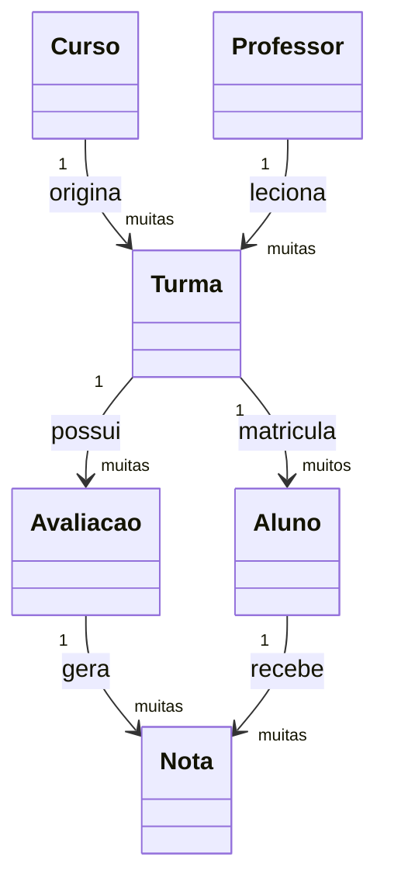

# Diagrama conceitual — o domínio do EduSmart

Diferente do diagrama de classes, o diagrama conceitual não mostra atributos nem métodos — ele mostra **os conceitos do domínio e como eles se relacionam entre si**, do jeito que fazem sentido para quem usa o sistema (professor, aluno, coordenação), antes de qualquer decisão de código. É a mesma ideia por trás do diagrama de componentes, só que aplicada ao negócio, não à arquitetura.

## Diagrama conceitual

## O que cada conceito representa

| Conceito | O que significa para o usuário |
|---|---|
| `Aluno` | A pessoa matriculada, que será avaliada ao longo da turma |
| `Professor` | A pessoa responsável por conduzir a turma |
| `Curso` | O programa de ensino ao qual a turma pertence |
| `Turma` | O agrupamento de alunos que cursam um curso com um professor |
| `Avaliacao` | Uma atividade pela qual o aluno é avaliado dentro da turma |
| `Nota` | O resultado do aluno em uma avaliação específica |

## Relações (o que liga cada conceito)

| Relação | De → Para | Sentido no domínio |
|---|---|---|
| origina | `Curso` → `Turma` | Um curso pode dar origem a várias turmas |
| leciona | `Professor` → `Turma` | Um professor pode lecionar várias turmas |
| matricula | `Turma` → `Aluno` | Uma turma reúne vários alunos matriculados |
| possui | `Turma` → `Avaliacao` | Uma turma tem uma ou mais avaliações |
| gera | `Avaliacao` → `Nota` | Cada avaliação gera uma nota por aluno |
| recebe | `Aluno` → `Nota` | Cada aluno acumula notas nas avaliações que fez |

## Fluxo básico do domínio

1. Um `Curso` e um `Professor` dão origem a uma `Turma`.
2. Um `Aluno` é matriculado nessa `Turma`.
3. A `Turma` possui uma ou mais `Avaliacao`.
4. Cada `Avaliacao` gera `Nota`s para os alunos que a realizaram.
5. As notas do `Aluno` na `Turma` formam a base da sua média final.

Diagrama conceitual responde principalmente: **o que existe no negócio, sem falar de código?**
