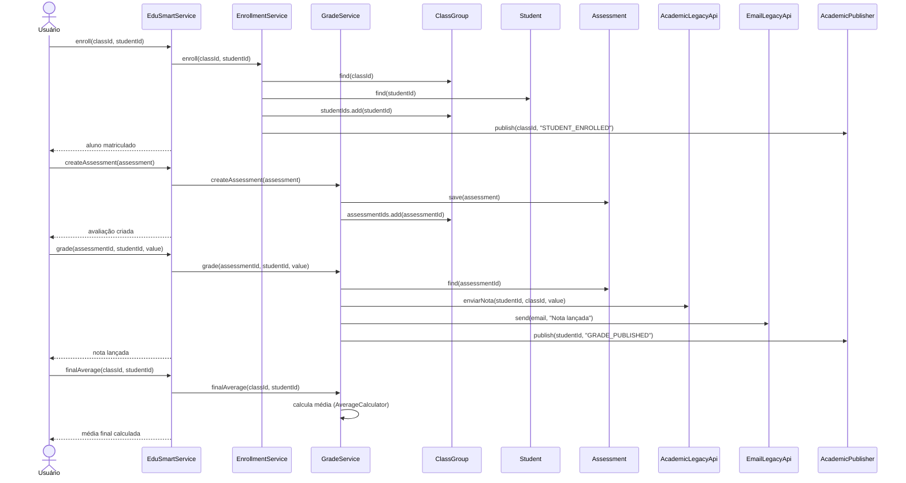

# Diagrama de sequência — fluxo principal do EduSmart

Diferente do diagrama de classes e do de componentes, o diagrama de sequência não mostra o que existe nem onde está organizado — ele mostra **o que acontece durante a execução**: quem participa, quem chama quem e em qual ordem as mensagens acontecem. Aqui, o fluxo cobre a jornada completa: matricular o aluno, criar a avaliação, lançar a nota e calcular a média final.

`EduSmartService` não executa essas etapas sozinho: desde a **ADR-0002** (`docs/adr/ADR-0002-extracao-de-responsabilidades.md`), ele apenas recebe a chamada do usuário e delega para `EnrollmentService`, `GradeService` ou `ClassClosingService`, que são quem realmente conversam com os repositórios e com os sistemas legados. O diagrama abaixo segue essa divisão real do código, não uma versão simplificada.

## Diagrama de sequência

## O que cada participante faz

| Participante | Papel na sequência |
|---|---|
| `Usuário` | Ator que dispara as ações (secretaria, professor ou coordenação) |
| `EduSmartService` | Ponto de entrada único; recebe a chamada e delega para o serviço certo (padrão Facade) |
| `EnrollmentService` | Confirma turma e aluno, e efetiva a matrícula (extraído na ADR-0002) |
| `GradeService` | Cria avaliações, lança notas e calcula a média final (extraído na ADR-0002) |
| `ClassGroup` | É consultada e atualizada para receber alunos e avaliações |
| `Student` | É consultado para confirmar que a matrícula é válida |
| `Assessment` | É criada e depois consultada na hora de lançar a nota |
| `AcademicLegacyApi` | Sistema acadêmico legado, acessado via Adapter, avisado a cada nota lançada |
| `EmailLegacyApi` | Serviço legado de e-mail, também via Adapter, avisa o aluno da nota |
| `AcademicPublisher` | Publica eventos (`STUDENT_ENROLLED`, `GRADE_PUBLISHED`) para quem observa a turma (padrão Observer) |

## O que a sequência responde

1. **Quem inicia a ação?** O usuário, chamando `EduSmartService`.
2. **Quem chama quem?** `EduSmartService` não fala com os repositórios — ele delega para `EnrollmentService` ou `GradeService`, que fazem o trabalho e acionam os sistemas legados e o publisher.
3. **Qual é a ordem?** Matricular → criar avaliação → lançar nota → calcular média — a mesma ordem do fluxo básico do diagrama de classes.
4. **Onde a tarefa termina?** Cada bloco de mensagens termina com uma resposta ao usuário (matrícula confirmada, avaliação criada, nota lançada ou média calculada).

Diagrama de sequência responde principalmente: **o que acontece durante a execução?**
